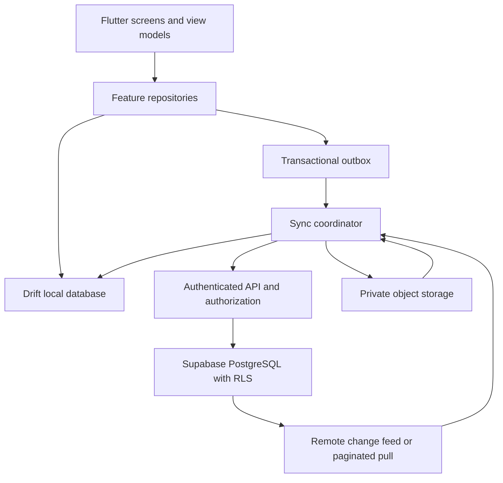

# PetUniverse — Offline Storage, Backend, and Synchronization Architecture

**Status:** Proposed technical direction  
**Version:** 0.1  
**Scope:** P0 local data, remote service, schema migrations, and synchronization  
**Implementation status:** Proposal only. No database package, backend credentials, SQL migration, or live Supabase project has been added.

## 1. Recommendation

The recommended baseline for review is:

| Layer | Proposed technology | Responsibility |
|---|---|---|
| App | Flutter | Android/iOS client; web is a development/preview target until its persistence and distribution needs are specified |
| Local database | SQLite through Drift | Device-side source of truth, relational queries, transactions, local schema migrations |
| Cloud database | Supabase PostgreSQL | Shared workspace records, remote authorization, synchronization target |
| Authentication | Supabase Auth | User identity and session management |
| File storage | Supabase Storage, private buckets | Cloud copy of photos and documents; Postgres stores metadata and links |
| Local file storage | App-private filesystem | Original files awaiting upload and files available offline |
| Sync | PetUniverse-owned outbox/inbox engine | Retry-safe push/pull, conflict detection, cursor tracking, attachment upload recovery |
| Local credentials | Platform secure storage | Session tokens and device secrets, separate from domain tables |

### Why this combination is proposed

PetUniverse has relational relationships: workspace memberships, species definitions, individual/group profiles, group membership history, habitat assignments, care logs, and measurement timelines. SQLite gives the device a relational store; Drift adds generated typed APIs, transactions, reactive queries, and schema migrations. The Flutter documentation specifically identifies SQLite/Drift for structured local persistence, while Drift documents those database features and support across Flutter platforms. [Flutter database choices](https://docs.flutter.dev/data-and-backend/persistence/choose-a-database) · [Drift](https://pub.dev/packages/drift).

For the cloud, PostgreSQL is a natural fit for the relational model and constraints. Supabase adds Auth, Storage, and Postgres Row Level Security (RLS) policies. Its Flutter client supports querying and mutating Postgres data, Auth, and Storage. [Supabase Flutter quickstart](https://supabase.com/docs/guides/getting-started/quickstarts/flutter) · [Supabase database overview](https://supabase.com/docs/guides/database/overview).

**Important:** Supabase is proposed as the cloud service, not as the offline database. The app must still write to Drift first and implement its own durable outbox, retry logic, pull cursor, and conflict policy. Flutter's offline-first architecture guidance describes repositories combining local and remote data sources and explains that offline writes require synchronization handling. [Flutter offline-first guide](https://docs.flutter.dev/app-architecture/design-patterns/offline-first).

## 2. Alternative comparison

| Option | Strengths | Trade-offs for PetUniverse | Direction |
|---|---|---|---|
| Drift + SQLite | Relational data, constraints, joins, transactions, migrations, reactive typed queries; local-first | Sync is a separate responsibility; web needs a separately validated storage setup | Preferred local store |
| sqflite + SQLite | Direct SQL, familiar SQLite model, Flutter recipe support | More manual mapping/query code; supported Flutter recipe targets Android/iOS/macOS, not a unified web solution | Viable alternative, not preferred |
| Hive / key-value store | Simple local settings and small values | Not a natural primary store for relational histories and workspace joins | Use only for small preferences if needed |
| Cloud Firestore | Client SDK provides offline cache and automatic sync for document data | Document data modeling and duplicated relationships may complicate group, assignment, and history relationships | Not preferred for this domain |
| Supabase PostgreSQL | Relational schema, SQL constraints, Auth, RLS, Storage, migrations | Requires explicit client-side outbox and conflict logic for offline-first writes | Preferred cloud proposal |
| Firebase SQL Connect | Managed relational/PostgreSQL direction | Different service stack and offline cache assumptions; still needs careful local-first workflow | Re-evaluate only if requirements change |

The alternatives are not exhaustive. This comparison is based on PetUniverse's current logical model and the current official Flutter, Drift, and Supabase documentation, not on a completed proof-of-concept or cost benchmark.

## 3. Application data flow

The UI must read and write through feature repositories. Widgets and view models must not call Drift tables or Supabase directly.



### Read path

1. The screen observes a repository query backed by local Drift data.
2. The local result appears without waiting for network access.
3. A refresh/sync request pulls authorized remote changes.
4. The repository applies valid remote changes to local tables transactionally.
5. Reactive queries update the screen.

### Write path

1. Validate the form and workspace context.
2. Generate stable IDs before persistence.
3. In one local transaction, write the domain data and the matching outbox operation.
4. Return a local-save result to the UI. Do not wait for cloud availability.
5. When eligible, the sync engine sends the operation using its stable operation ID.
6. The server validates identity, membership, permission, workspace ownership, base version, and payload.
7. The server records the operation result and applies the change atomically.
8. After server acknowledgement, mark the local operation synced and store the server revision.
9. If a conflict is detected, keep the local pending state and show a conflict/review status instead of silently replacing either side.

A successful local save must be described as **Tersimpan di perangkat**, not "tersinkronisasi".

## 4. Proposed Flutter code boundaries

Proposed directory structure (not yet created):

```text
app/lib/
  core/
    database/
      app_database.dart
      connection/
      tables/
      daos/
      migrations/
    network/
      supabase_client_provider.dart
    sync/
      sync_coordinator.dart
      outbox_repository.dart
      sync_models.dart
    security/
      capability.dart
      permission_service.dart
  features/
    animals/
      data/
        animal_local_data_source.dart
        animal_remote_data_source.dart
        animal_repository_impl.dart
      domain/
        animal.dart
        animal_repository.dart
        animal_validators.dart
      presentation/
    species/
    habitats/
    care/
    health/
    attachments/
```

Rules:
- Domain models do not depend on Drift-generated row classes or Supabase response objects.
- Local and remote data source mappings live at the data boundary.
- Repositories are the only place that coordinates local writes and remote synchronization requests.
- View models expose loading, saved-locally, queued, synced, and conflict states.
- Database transactions own multi-row atomic changes.
- Do not add all planned packages at once. Add a dependency only when its first implementation and tests are ready.

## 5. Local database proposal

### 5.1 Storage rules

- Use a single local relational database per installed app profile, partitioned by workspace IDs.
- Store IDs as stable text UUIDs or another explicitly standardized ID encoding. Choose the generator and canonical format before migration 1.
- Include `workspace_id` on every workspace-owned row, even when it can be reached through another record. This supports tenant checks and filtering.
- Store timestamps in one canonical UTC representation and convert to display timezone at the UI boundary.
- Store numerical values with explicit unit codes.
- Keep unknown/null distinct from zero, empty string, false, and not applicable.
- Use foreign keys and indexes for common workspace, profile, date, and status queries.
- Keep historical event rows (care logs, measurements, health observations, group membership, habitat assignments) separate from mutable profile fields.
- Store large binary attachments in app-private files, not as database blobs by default. Store size, MIME type, checksum, path/storage key, and upload state in the database.
- Store authentication tokens and secrets in platform secure storage, never in ordinary domain tables or checked-in config.

### 5.2 Initial local tables

The first local migration should not create every future table. Build in small, tested slices. The first core schema will likely require:

- `workspaces`
- `workspace_memberships` (local cached membership/role data; server remains authoritative)
- `species`
- `species_sources`
- `species_attribute_definitions`
- `animal_profiles`
- `individual_details`
- `group_details`
- `group_memberships`
- `habitats`
- `animal_habitat_assignments`
- `attachments`
- `attachment_links`
- `sync_outbox`
- `sync_state`

Care, health, feeding, measurements, notifications, and audit local projections can be added in later migrations as those features are implemented. Do not create a monolithic schema simply to match a document list.

### 5.3 Transaction examples

Create an individual profile:
- Insert `animal_profiles` row.
- Insert exactly one `individual_details` row.
- Insert typed dynamic attributes (if any).
- Insert habitat assignment if selected.
- Insert one outbox envelope representing the aggregate operation.
- Commit the transaction only if all required inserts succeed.

Create a group profile:
- Insert `animal_profiles` row with kind group.
- Insert exactly one `group_details` row.
- Insert known member links if supplied.
- Insert habitat assignment if selected.
- Insert outbox operation(s) in a defined order.
- Commit as one logical local action.

If any step fails, roll back the entire transaction and keep the form's entered values in memory so the user can retry.

## 6. Migration strategy

Two schemas evolve independently and must be versioned independently.

### 6.1 Local SQLite/Drift

- Track local schema with Drift's schema version and migration strategy.
- Keep migration code in source control; do not manually change a released database schema without a migration.
- Add migration tests for each supported previous schema version.
- Test both fresh database creation and upgrade from a prior version.
- Test preservation of profiles, histories, measurements, outbox operations, and attachment metadata during upgrades.
- Prefer additive/expand migrations before any destructive change.
- Do not delete or rewrite user data as a shortcut to resolving schema mismatch.
- Define a backup/restore strategy before any destructive migration or major version transition.
- Keep Drift schema snapshots or equivalent migration-test fixtures as required by the chosen Drift release.

### 6.2 Cloud PostgreSQL/Supabase

If Supabase is selected:
- Keep SQL migrations in `supabase/migrations/<timestamp>_<description>.sql`.
- Keep non-sensitive seed fixtures in `supabase/seed.sql`.
- Keep RLS policy tests under `supabase/tests/`.
- Develop and test changes against a local Supabase stack before applying them to a hosted project.
- Apply RLS grants and policies in the same reviewed migration as the tables they protect.
- CI should reset a disposable test database, apply migrations, run database tests, and reject unauthorized access.
- Production schema changes are deployed only through reviewed migration files; avoid Dashboard-only schema edits that are not captured in version control.

Supabase's CLI documentation describes local development, version-controlled migration files, seed data, and deployment of migrations. [Local migration workflow](https://supabase.com/docs/guides/local-development/database-migrations).

### 6.3 Version dimensions

Keep these separate:
- app version;
- local database schema version;
- remote database schema/migration version;
- species/content package version;
- sync protocol version.

A content package must declare its minimum compatible app and schema versions. A schema change must not be smuggled into a species content ZIP.

## 7. Outbox and sync protocol

### 7.1 Outbox envelope

Suggested fields:
- `operation_id` — stable client-generated idempotency ID.
- `workspace_id`.
- `entity_kind`, `entity_id`.
- `operation_kind` — create, update, archive, or delete/tombstone.
- `base_server_version` — revision that was last observed by this client, nullable for a new record.
- `payload_version`.
- `payload` or a stable immutable payload reference.
- `created_at`, `attempt_count`, `next_attempt_at`.
- `status` — pending, in_progress, retry_wait, conflict, blocked, or synced.
- `last_error_code` and a privacy-safe diagnostic summary.

The server should keep a unique operation ledger (for example, unique workspace + operation ID) and return the same acknowledgement for duplicate operation submissions. Applying the domain change and recording its operation acknowledgement must be atomic on the server.

### 7.2 Sync sequence

1. Confirm an authenticated session and active workspace membership.
2. Check whether the device has a usable network connection; a connectivity indicator alone does not prove the service is reachable.
3. Push pending operations in dependency order.
4. Receive acknowledgement, canonical record revision, or conflict response.
5. Pull remote changes after the saved workspace cursor.
6. Apply remote changes in local transactions, preserving local pending changes.
7. Update the cursor only after all changes up to that point are committed locally.
8. Resume pending attachment uploads.
9. Refresh the UI sync state.

Initial sync requires a workspace-scoped snapshot plus a cursor/watermark so changes made during the snapshot are not skipped. Cursor pagination and server revision semantics must be specified with the backend API.

### 7.3 Ordering and dependencies

Examples:
- Workspace before its domain records.
- Species definition before an attribute value that references it, unless the species is a permitted unclassified/custom pending value.
- Animal profile before group membership, habitat assignment, and event records.
- Attachment metadata before remote binary upload completion.
- Tombstone processing must not remove data until the server has acknowledged the delete and retention rules permit purge.

The sync engine must not assume that local record creation order and server arrival order are identical.

## 8. Conflict policy proposal

| Record category | Proposed default |
|---|---|
| Append-only care/feeding/measurement/health observation | Keep both distinct events; operation ID prevents duplicate retries |
| Profile name and ordinary descriptive fields | Compare base revision; merge non-overlapping field edits where safe; ask user when the same field conflicts |
| Species/attribute definition changes | Validate against definition version; unsupported versions are blocked for review, never silently discarded |
| Group membership history | Preserve effective-date history; concurrent membership changes require deterministic validation or review |
| Habitat assignments | Preserve both event history and valid intervals; competing active primary assignments require review |
| Care schedule | Keep server revision and local proposal; conflicting recurrence or due-time edits require review |
| Attachment upload | Retry by checksum/object identity; do not mark uploaded before server confirms integrity |
| Archive/delete tombstone | Do not silently resurrect from a stale update; require explicit restore/resolve flow |

"Last write wins" must not be used globally. It may be acceptable for a narrowly defined low-risk preference field, but not for historical records, group membership, habitat movements, or health information.

## 9. Attachment lifecycle

- Copy chosen files into app-private storage before creating a durable upload task.
- Compute and persist a checksum, byte size, MIME type, and original file name.
- Create local attachment metadata and link rows in a transaction.
- Queue binary upload separately from domain-row sync.
- Upload to a private workspace-scoped storage key; never construct a public URL as the security boundary.
- Resume/retry safely after interruption. Use the checksum to validate the completed object where supported.
- Mark the attachment uploaded only after the server confirms the object and metadata.
- Download/cache files only when permitted by the linked record.
- Deleting one attachment link must not delete a file that is linked elsewhere.
- Database backups and object-storage backups are separate concerns. Supabase documentation notes that database backups do not include Storage objects; define a separate backup/recovery plan for media. [Supabase database overview](https://supabase.com/docs/guides/database/overview) · [Storage access control](https://supabase.com/docs/guides/storage/security/access-control).

## 10. Security and tenant isolation

- Every remote table exposed to the client must have explicit grants and RLS policies.
- Policies must check active membership and the operation capability against the current authenticated user.
- Test SELECT, INSERT, UPDATE, and DELETE separately. A policy can filter out a row without raising an error; tests must verify the actual returned/remaining data.
- Add indexes for columns commonly used in membership and workspace policy predicates.
- Never use user-editable profile metadata as the authoritative source of roles.
- A service/secret key that bypasses RLS is server-only and must never be bundled into Flutter or Web assets.
- Storage buckets for animal photos and private documents must be private and protected by access policies that match the linked record's workspace and permissions.

Official Supabase guidance requires careful grants and RLS policy design for exposed tables, and its Storage access control is also based on RLS policies. [RLS documentation](https://supabase.com/docs/guides/database/postgres/row-level-security) · [Storage access control](https://supabase.com/docs/guides/storage/security/access-control).

## 11. Recovery, backup, and retention

Before production:
- Decide whether locally stored data is encrypted at rest and select a validated approach for the target platforms.
- Define what happens if app data is cleared, an app is uninstalled, or a device is lost.
- Provide an authorized export/backup path for local-only workspaces.
- Define cloud database backup and object-storage backup separately.
- Define retention and account deletion behavior for health records, attachments, audit rows, and tombstones.
- Test restore, not only backup creation.
- Never treat cloud sync as a substitute for a user-visible backup policy.

## 12. Acceptance criteria for the storage layer

- [ ] Create and read a profile with no network.
- [ ] Close/reopen the app and confirm the profile remains.
- [ ] Create profile + subtype + initial habitat + outbox atomically.
- [ ] Simulate local database failure and verify no partial profile is left.
- [ ] Retry one outbox operation multiple times; remote result appears exactly once.
- [ ] Remove network during attachment upload, reconnect, and confirm safe recovery.
- [ ] Simulate simultaneous edits on two devices and verify the conflict policy.
- [ ] Confirm a historical health/care/measurement entry is never silently overwritten.
- [ ] Confirm a removed member loses remote access.
- [ ] Confirm Reader and Care Staff cannot perform denied actions.
- [ ] Upgrade from each supported local DB schema version without loss.
- [ ] Restore a backup and verify attachments as well as database rows.

## 13. Proposed implementation sequence

1. Approve logical model and permission matrix.
2. Confirm database/backend direction and whether a cloud account is needed at P0.
3. Add Drift dependencies and one empty local DB, with tested migration 1.
4. Add workspace and species repositories.
5. Add animal profile + individual/group subtype repositories and validators.
6. Build profile creation screens using repository interfaces.
7. Add habitat assignment history and tests.
8. Add outbox operation storage and deterministic sync tests with a fake server.
9. Provision a non-production Supabase project; add migrations, RLS, Auth, and private Storage.
10. Implement remote data sources and sync API in staged increments.
11. Add permission/tenant tests and attachment recovery tests.
12. Only then enable production sync and collaboration.

## 14. Open implementation decisions

- Final approval of Drift + SQLite and Supabase/PostgreSQL.
- Exact Drift SQLite platform driver and Web preview storage arrangement.
- Authentication provider and when local workspaces link to an account.
- Whether the first P0 release is useful offline-only before cloud collaboration ships.
- Sync API shape: direct Postgres operations vs authenticated RPC/Edge Function batches.
- Server change cursor/retention mechanism.
- Local DB encryption approach and device-key lifecycle.
- Attachment size limits, supported media types, resumable upload provider behavior.
- Conflict UX for same-field and historical event changes.
- Backup/export, data retention, and account deletion requirements.

**No production dependency or schema migration should be added until this proposal is reviewed and the storage direction is approved.**

## 15. References

- [Flutter database choices](https://docs.flutter.dev/data-and-backend/persistence/choose-a-database)
- [Flutter offline-first architecture](https://docs.flutter.dev/app-architecture/design-patterns/offline-first)
- [Flutter SQLite persistence recipe](https://docs.flutter.dev/cookbook/persistence/sqlite)
- [Drift package and documentation](https://pub.dev/packages/drift)
- [Supabase Flutter quickstart](https://supabase.com/docs/guides/getting-started/quickstarts/flutter)
- [Supabase Row Level Security](https://supabase.com/docs/guides/database/postgres/row-level-security)
- [Supabase Storage access control](https://supabase.com/docs/guides/storage/security/access-control)
- [Supabase database migrations](https://supabase.com/docs/guides/local-development/database-migrations)
