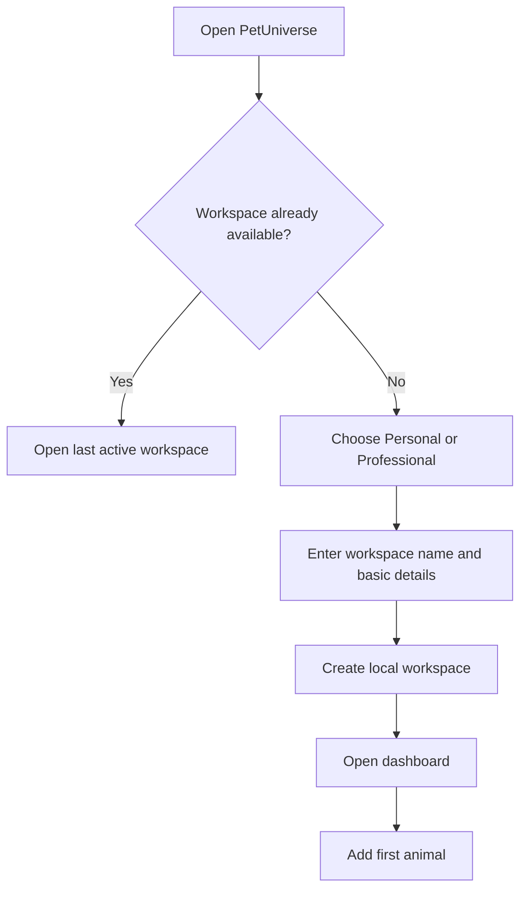
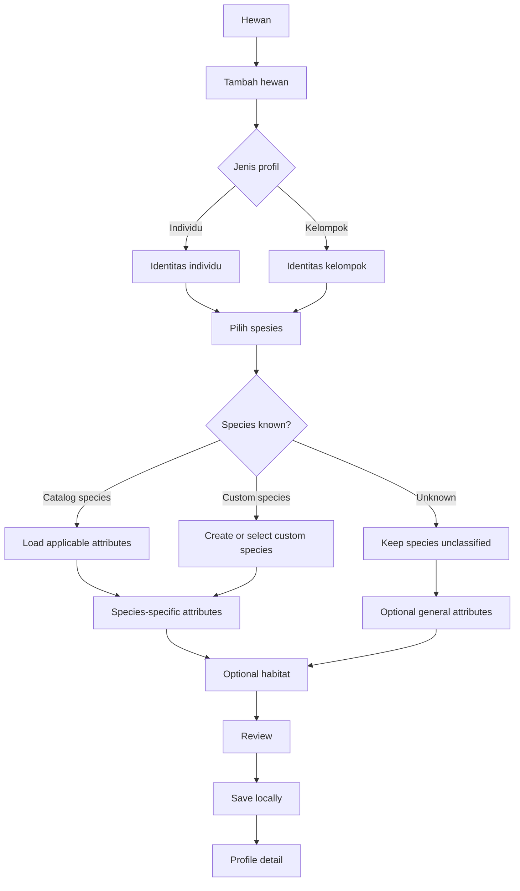
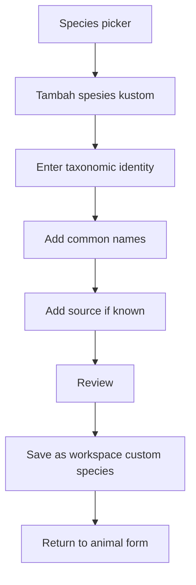

# PetUniverse — Screen Flows and Animal Profile Forms

**Status:** Proposed UX specification  
**Version:** 0.1  
**Scope:** P0 user journeys and first profile forms  
**Implementation status:** Specification only; the current Flutter screens remain a visual shell.

This document defines the proposed user journey and form behavior for the first usable PetUniverse animal-management flow. It follows the logical entities in [Core Data Model](../architecture/DATA_MODEL.md). It does not select a database, implement persistence, or decide a cloud backend.

## 1. UX objectives

- Make the first successful animal profile quick to create without forcing the user to know every biological detail.
- Support individuals and groups as distinct record types.
- Keep Personal and Professional workspaces on the same domain model.
- Display only the species-specific fields that apply to the selected record kind and its catalog definition.
- Allow a profile to remain partially unknown; never force guessed values.
- Keep habitat assignment optional during initial profile creation.
- Preserve a clear path from profile to habitat, care, health, feeding, and measurement history.
- Make offline status and local save outcomes understandable.
- Prevent workspace data from appearing in another workspace.

## 2. Navigation model

### 2.1 Main destinations

| Destination | Primary purpose | First-release screen |
|---|---|---|
| Beranda | Workspace overview and shortcuts | Dashboard |
| Hewan | Individual and group profiles | Animal list and profile detail |
| Habitat | Environments and assignment history | Habitat list and detail |
| Jadwal | Planned care activities | Schedule list and task detail |
| Kesehatan | Health records | Health list and record detail |
| Katalog spesies | Reference and custom species | Species search and detail |
| Lainnya | Secondary modules and settings | More menu |

On desktop, destinations appear in the left sidebar. On narrow screens, the primary destinations appear in bottom navigation and less frequent destinations appear in Lainnya.

### 2.2 Workspace selector

- There is one global workspace selector in the application shell.
- The dashboard may show the active workspace name and type, but should not repeat a second interactive mode selector.
- Changing the workspace changes the data scope for every destination.
- If a form has unsaved input, the app must ask whether to keep editing, discard, or save a draft before switching.
- Workspace selection must never merge or copy data.
- The current selected workspace should be visibly identifiable on every major screen.

The existing dashboard currently repeats the Personal/Professional selector in the header and workspace card. The intended design is to retain the global selector and convert the dashboard card to read-only workspace context.

## 3. First-run and workspace flow

### 3.1 Proposed flow

### 3.2 First-run fields

| Field | Requirement | Notes |
|---|---|---|
| Workspace type | Required | Personal or Professional |
| Workspace name | Required | Personal may use a suggested default that the user can edit |
| Display name | Optional | Local profile label; authentication identity is separate |
| Country/locale | Optional | Used for language, dates, and units; do not infer a species or care rule from it |
| Preferred measurement units | Optional | User preference only; each stored measurement still retains its own unit |

Account creation, authentication providers, invitation acceptance, and team provisioning are not part of this first local flow. They remain separate decisions for the identity/backend phase. A local workspace created before sign-in must be designed for safe account linking and sync later.

## 4. Animal management flow

### 4.1 List screen

The Hewan screen should include:
- Search by display name, common name, scientific name, and identification code where available.
- Filters for individual/group, species, profile status, and current habitat.
- A visible empty state when no profiles exist.
- A clear primary action: Tambah hewan.
- A list/card layout that identifies whether a record is an individual or group.
- No fabricated counts. Show a group count only with its meaning, e.g. tracked members or estimated count.

Empty-state action:
1. Tambah hewan.
2. Choose Individu or Kelompok.
3. Continue to the appropriate form.

### 4.2 End-to-end flow

### 4.3 Profile creation pattern

Use a short stepper/wizard on mobile and a clear multi-section form on desktop. Preserve entered values when moving between steps.

Proposed steps:
1. Jenis profil.
2. Identitas.
3. Spesies dan atribut.
4. Habitat (optional).
5. Tinjau dan simpan.

The user must be able to go back without losing input. The app should not require completing optional sections before saving.

## 5. Form specification — shared profile fields

These fields apply to both individual and group profiles unless noted otherwise.

| Field | Required? | Type | Behavior |
|---|---|---|---|
| Jenis profil | Yes | Individual / Group | Chosen before opening the form |
| Nama profil | Yes | Text | User-facing name; trim whitespace |
| Spesies | No | Catalog / custom / unclassified | May remain unknown |
| Status | System default | Active / archived / closed as appropriate | New profiles start active |
| Catatan | No | Multiline text | Plain notes; no diagnosis assumptions |
| Kode identifikasi | No | Type + value | Optional tag, ring, microchip, or user-defined code; uniqueness within workspace when supplied |
| Habitat utama | No | Existing habitat or create new | Assignment history starts when confirmed |

Validation:
- Name cannot be empty after trimming.
- Name length and control-character limits should be defined in implementation validation.
- Identification uniqueness is checked within the active workspace and should explain conflicts without silently replacing another profile.
- The app must allow two animals with the same display name when their identification differs or no identification is supplied.
- Species may be unknown. The UI must not force a best-guess species.

## 6. Individual profile form

Show these fields after the user chooses Individu.

| Field | Required? | Type | Behavior |
|---|---|---|---|
| Jenis kelamin | No | Species-defined choice | Options come from the species definition; allow unknown/not observed |
| Tanggal lahir | No | Date | Optional |
| Ketepatan tanggal lahir | Conditional | Exact / estimated / unknown | Required only if a birth date is entered |
| Tanggal diperoleh | No | Date | Optional |
| Tahap hidup | No | Species-defined choice | May be selected or derived only when a valid catalog rule exists |
| Sumber tahap hidup | System/conditional | Observed / user selected / derived | Keep provenance when derived |
| Identifikasi fisik | No | Type + value | Optional and species/context aware |

Rules:
- Do not infer sex from appearance or species.
- Do not calculate an exact age when birth date is unknown.
- If date precision is estimated, show that label wherever the date is presented.
- Derived life stage must retain the rule/catalog version. If no supported rule is available, require user selection or leave unknown.
- An animal may be saved with only a name and unknown species.

## 7. Group profile form

Show these fields after the user chooses Kelompok.

| Field | Required? | Type | Behavior |
|---|---|---|---|
| Nama kelompok | Yes | Text | Stored as shared profile display name |
| Tujuan kelompok | No | Text/category | User-defined purpose |
| Spesies kelompok | No | Catalog/custom/unclassified | Set only when intentionally classifying the group as one species |
| Pelacakan anggota | Yes | Tracked / estimated / not tracked | Determines how count is displayed |
| Jumlah anggota perkiraan | Conditional | Non-negative integer | Used for estimated or not-tracked mode; never fabricate a count |
| Waktu pengamatan jumlah | Conditional | Date/time | Required when an estimated count is entered |
| Catatan jumlah | No | Text | Explain estimate or counting method |
| Anggota | No | Existing individual profiles | Can be linked now or later |

Rules:
- Version 1 supports group membership of individual profiles only. Nested groups are not supported.
- A group can exist without its members being individually profiled.
- In tracked mode, display the count of active membership records; do not also ask the user to type a competing count.
- In estimated mode, show the number as “Perkiraan”, with its observation date.
- In not-tracked mode, do not display a numeric count unless the user enters an explicitly labeled estimate.
- A mixed-species group should leave group-level species unclassified and retain species on its individual members.
- Adding an existing member must validate that the individual belongs to the same workspace.
- Membership start/end dates preserve group membership history.

## 8. Species picker and custom species

### 8.1 Species picker

The picker should provide:
- Search across common and scientific names.
- Grouping by broad animal category for navigation, without limiting search results to one category.
- A species detail preview with common name, scientific name, taxonomic rank, and available source/validation information.
- A visible option “Belum diketahui / belum diklasifikasikan”.
- A separate action “Tambah spesies kustom”.
- An indication when a catalog entry is draft, reviewed, published, deprecated, or unavailable offline.

The UI must distinguish “not found in the local catalog” from “species does not exist”.

### 8.2 Custom species flow

Minimum proposed fields:
- Scientific name or a user-defined label, depending on known information.
- Taxonomic rank.
- One or more common names, with locale where available.
- Optional parent taxon.
- Optional source name, URL, and usage note.
- Status defaults to draft/unreviewed until validated.

Custom species is scoped to the active workspace and must never modify shared catalog data. Custom species may initially have no attribute definitions; the user can still save an animal with basic identity information. A future attribute-definition editor is a separate advanced flow and must not expose executable expressions or code.

## 9. Species-specific attributes

After species and profile kind are selected, the form loads the active, supported attribute definitions matching:
- selected species;
- individual, group, or both;
- definition version and status;
- any future supported life-stage or habitat applicability rules.

Display rules:
- Group attributes by the definition category.
- Use the field control that matches the declared value type.
- Show unit beside every measurement input.
- Render required indicators based on the definition.
- Show a help/description when supplied.
- Do not render unsupported field types as free text.
- If a definition version is not supported by the app, show an explicit compatibility message and do not silently drop values.

Profile attributes and repeated measurements are separate:
- Descriptive facts such as coat type or breed variant may be profile attributes.
- Repeated observations such as weight, body length, water temperature, or pH belong in measurement history.

## 10. Habitat assignment flow

Habitat assignment is optional when creating an animal. The user may skip it and assign a habitat later.

Proposed flow:
1. Choose habitat type or search existing habitat.
2. Select a habitat in the current workspace.
3. Preview name, type, hierarchy/location, and status.
4. Confirm assignment date/time and whether it is the primary habitat.
5. Save the assignment as a historical record.

Quick-create habitat during animal setup should collect only name, habitat type, and optional parent habitat. Full environmental attributes can be added on the Habitat screen later.

Rules:
- Inactive or archived habitat is not offered as a new assignment target by default.
- Reassignment closes the former active assignment and creates a new record; it does not overwrite history.
- A group assignment does not silently create individual assignment records for all group members.
- Multi-habitat assignment behavior and the “one active primary habitat” constraint need final approval before physical database constraints are created.

## 11. Review and save screen

Before saving, show a compact summary:
- Profile name and kind.
- Species or “Belum diklasifikasikan”.
- The individual or group-specific details entered.
- Habitat assignment, if any.
- Required-field errors and warnings.
- A distinction between saved values, unknown values, and omitted optional values.

Save behavior:
- Save locally first.
- Generate stable IDs before the record is written.
- Persist the profile and its subtype details as one logical operation; do not leave a half-created profile if a local write fails.
- If a local write fails, keep the form values and show an actionable error.
- If local save succeeds while offline, show “Tersimpan di perangkat” and do not claim cloud sync is complete.
- If a sync queue exists in a later release, show “Menunggu sinkronisasi” until the server confirms.
- Do not clear the form until local save succeeds.

## 12. Animal profile detail screen

Proposed information hierarchy:

1. Header: display name, kind badge, species, status, and primary actions.
2. Overview: key identity details and current habitat.
3. Attributes: species-specific descriptive fields.
4. Timeline: care, health, feeding, measurement, habitat, and membership events.
5. Care: upcoming schedules and recent care logs.
6. Health: health records and measurements.
7. Attachments: photos and documents.

On small screens, use scrollable sections or tabs with clear labels. Avoid a dense table layout on mobile.

Primary actions:
- Edit profile.
- Add care record.
- Add health record.
- Add measurement.
- Change habitat.
- Archive profile.

Deletion should not be the primary action. Archive is reversible in the UI; permanent deletion follows the tombstone and retention process.

For group profiles, show active/estimated member count with its type and date, plus a member list and membership history. Each member opens its own individual profile.

## 13. Edit, archive, and removal flows

- Editing a profile updates mutable descriptive fields and records update metadata.
- Historical events (care logs, health records, measurements, habitat assignments, group membership) are corrected through a history-aware action rather than overwritten without trace.
- Archiving removes a profile from the default active list but keeps its history accessible.
- Marking an individual deceased/closed is distinct from archiving and must use a deliberate confirmation with date and optional note.
- Deletion creates a tombstone and follows a later approved retention policy. The app must not cascade-delete health, care, measurement, habitat, or audit history silently.

## 14. Professional workspace screen behavior

Professional mode uses the same animal and habitat forms. Differences are introduced through workspace and role capabilities:
- Show workspace name and, when implemented, the current user's role.
- Display member identity on care and health records where permissions allow.
- Allow managers to assign work only after the task-assignment model is approved.
- Allow readers to browse only what their role permits.
- Show activity/audit history for high-impact changes after audit support exists.

A full member invitation flow, permission editor, role matrix, and team task assignment remain outside this form specification and need their own design.

## 15. Screen-level acceptance criteria

### Animal list
- [ ] Empty state has one clear add action.
- [ ] Search and filters distinguish individual and group records.
- [ ] Every row/card indicates the record kind.
- [ ] Workspace isolation is enforced.

### Individual profile
- [ ] A profile can be saved with only its required name.
- [ ] Unknown species, sex, birth date, and life stage remain unknown.
- [ ] Estimated birth date is visibly labeled.
- [ ] Species-specific fields come from definitions, not hard-coded category checks.
- [ ] Measurements retain unit and observation date.

### Group profile
- [ ] A group can be saved without individual member profiles.
- [ ] Tracked count is derived from active membership rows.
- [ ] Estimated count is labeled and timestamped.
- [ ] Mixed-species group behavior is supported without assigning a false group species.
- [ ] Group membership history is preserved.

### Habitat
- [ ] Habitat assignment may be skipped.
- [ ] Changing habitat preserves the previous assignment.
- [ ] Group assignment does not create hidden individual assignment rows.

### Save and offline behavior
- [ ] Local save is atomic for the profile and subtype details.
- [ ] Form input survives a failed local save.
- [ ] Offline save does not claim cloud synchronization.
- [ ] No historical record is silently lost by edit, archive, or removal.

## 16. Open UX decisions for review

These are proposed defaults, not final product decisions:

1. **Profile creation:** five-step wizard with back navigation and a final review screen.
2. **Required fields:** profile name only, plus the structural record kind; all other fields are optional unless a selected species definition explicitly marks an attribute required.
3. **Unknown species:** allow save as unclassified.
4. **Group member creation:** create/link members after group creation or from a dedicated member-management action; do not force creation of every member during the initial group form.
5. **Habitat:** optional at initial profile creation; quick-create only the minimum habitat fields.
6. **Workspace selector:** one global control in the app shell; remove the duplicate interactive control from the dashboard card.
7. **Local-first feedback:** clearly distinguish local save from server synchronization.

## 17. Next implementation gate

Before creating the actual forms:
- Review this screen-flow specification and the logical data model together.
- Approve the profile and group form fields.
- Finalize the workspace permission matrix.
- Select local database and migration strategy.
- Define validation and repository interfaces.
- Define acceptance tests for individual, group, custom species, unknown values, and habitat history.

Only after that gate should Flutter forms, repositories, migrations, and storage be implemented.
